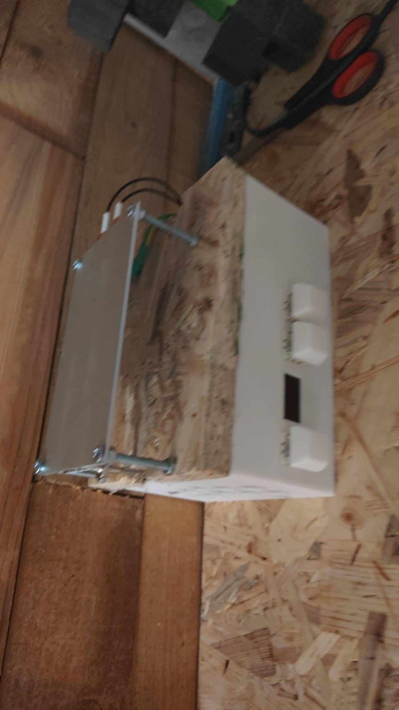

# Hotplate

A DIY reflow hotplate controller built on a Raspberry Pi Pico (RP2040), with an SSD1306 OLED display, a MAX6675 thermocouple, and a PTC heater switched by an SSR.

## Features

- Read temp from a MAX6675 thermocouple
- Adjustable target temperature (5–260 °C, in 5 °C steps)
- Simple on/off control with thermal lag compensation and overshoot protection (needs work on but is 99% done)
- 128x64 I2C OLED status display
- Thermal runaway protection (cuts the heater if the Pico overheats or the sensor reads out of range)

## Hardware

| Component | Connection |
|---|---|
| SSD1306 OLED | I2C (`Wire1`): SDA GP2, SCL GP3, address `0x3C` |
| MAX6675 thermocouple | CLK GP6, CS GP7, SO GP8 |
| Heater (SSR/transistor) | GP4 |
| Button `+` | GP9 |
| Button `-` | GP10 |
| Button `OK` | GP11 |

## Usage

- `+` / `-` — change the target temperature (only while the heater is off)
- `OK` — toggle the heater on/off

The current plate temperature, Pico temperature, and target temperature are shown on the OLED and logged over serial at 9600 baud.

## Build

Open `hotplate.ino` in the Arduino IDE with the **Raspberry Pi Pico/RP2040** board package installed, then install the libraries:

- `Adafruit SSD1306`
- `Adafruit GFX`
- `max6675` (MAX6675 thermocouple library)

Select your Pico board and upload.

## Safety

This project controls a heater that can reach high temperatures. Use a properly rated SSR and heatsink, keep the thermocouple well attached to the plate, and never leave the hotplate unattended while it is on.

## DISCLAIMER

You build and use this project strictly at your own risk. I have no liability for hardware damage, financial loss, or bodily harm resulting from the use or building of the project.
